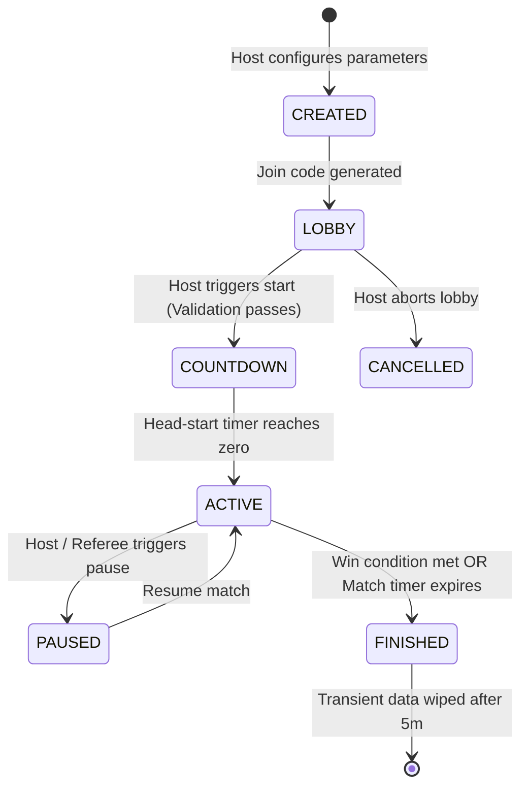

# Technical Architecture: GPS Multiplayer Manhunt

## 1. Overview & System Topology

The system is a real-time, cross-platform mobile game built for physical outdoor chase gameplay. It balances low-latency spatial synchronization with strict privacy controls, battery efficiency, and cheat-proof authoritative game logic.

```
                      +---------------------------------------+
                      |       Supabase Backend / Node         |
                      |  - PostgreSQL + PostGIS (Spatial)     |
                      |  - Auth & Row-Level Security (RLS)    |
                      |  - Edge Functions / Game Server API   |
                      |  - Supabase Realtime (Channels/State) |
                      +---------------------------------------+
                                    ^           ^
               Authenticated REST / |           | Subscribed
                 RPC Operations     |           | Authorized Snapshots
                                    v           v
           +-------------------------------------------------------+
           |           React Native / Expo Mobile Client           |
           |  - Cross-platform: Android (Primary) & iOS            |
           |  - Native Foreground Service (GPS Background Tracking)|
           |  - Magnetometer + GPS Geodesic Bearing Engine         |
           |  - High-Contrast Outdoor Dark HUD                     |
           +-------------------------------------------------------+
              |                                            |
              v                                            v
     [ Hunter Interface ]                         [ Runner Interface ]
  - Filtered Radar / Map                       - Geodesic Target Compass
  - Periodic Location Snapshots                - Proximity Threat Meter
  - Catch Request Trigger                      - Stealth / Map View Abilities
```

---

## 2. Technology Stack & Trade-Off Analysis

### 2.1 Mobile Application
- **Framework**: React Native with **Expo SDK 52+** and **TypeScript**.
  - *Trade-off*: Rapid cross-platform development while supporting config plugins for native Android Foreground Services (`expo-location` background task).
- **Navigation**: Expo Router (file-based navigation with strict typed routing).
- **Location & Sensors**:
  - `expo-location`: High-accuracy GPS with `Accuracy.BestForNavigation`, distance filtering, and background task registration.
  - `expo-sensors`: Magnetometer for real-time device heading calculation.
- **Mapping**: `@react-native-maps` / Leaflet / Mapbox or web-compatible canvas fallback for rapid testing, with standard OSM/CartoDB tiles (dark mode, battery and outdoor sunlight friendly).
- **State Management**: Zustand for lightweight local game state + Supabase client for realtime replication.

### 2.2 Backend & Data Layer
- **Database**: PostgreSQL 15+ with **PostGIS** extension for spatial indexing (`ST_DWithin`, `ST_Point`, `ST_Distance`).
- **Security**: PostgreSQL Row Level Security (RLS) policies ensuring players NEVER receive unauthorized enemy coordinates over the wire.
- **Authoritative Game Logic**:
  - PostgreSQL Stored Functions (`RPC`) and Supabase Edge Functions for all privileged actions (`start_game`, `catch_runner`, `activate_ability`, `sync_location_visibility`).
- **Realtime Layer**: Supabase Realtime (Postgres Changes + Broadcast Channels for low latency peer events).

---

## 3. Authoritative Game State Machine



### State Definitions & Authoritative Guards:
1. **CREATED**: Match record initialized with parameters (duration, play zone circle/polygon, update frequency, ability cooldowns).
2. **LOBBY**: Players join via 6-character code, choose roles (Hunter, Runner, Referee). Ready statuses tracked.
3. **COUNTDOWN**: Match locked; head-start period (default 60s) where runners disperse. Radar is dark; catches are disabled.
4. **ACTIVE**: Live chase active. GPS updates streamed. Periodic snapshots distributed according to game rules.
5. **PAUSED**: Emergencies or boundary safety issues. Timers freeze; catches disabled.
6. **FINISHED**: Authoritative victory evaluation (All runners eliminated = Hunters win; Time expires with >= 1 runner alive = Runners win).
7. **CANCELLED**: Host cancelled prior to launch.

---

## 4. Asymmetric Information Architecture (Zero Data Leaks)

A critical security vulnerability in casual multiplayer games is sending raw opponent coordinates to the client and expecting the client UI to "hide" them. **Our architecture strictly prevents this at the database/API level.**

1. **Raw Location Submissions**:
   - `POST /rpc/submit_player_location`: Runners and Hunters send raw GPS coordinates (`latitude`, `longitude`, `accuracy`, `heading`, `speed`, `measured_at`).
   - Saved in table `player_locations`.
   - **RLS Policy**: Only the player who submitted the location, and authorized Referees, can query `player_locations`. Opponents have ZERO SELECT permission on this table!

2. **Authorized Snapshot Generation (`location_visibility_snapshots`)**:
   - Authoritative backend job / trigger executes snapshot distribution:
     - For **Hunters**: Only visible runner coordinates according to the match interval (e.g., every 30s) are written to `location_visibility_snapshots`. If a runner has active **Stealth**, their snapshot is omitted.
     - For **Runners**: Hunter coordinates are NEVER exposed as map points. Only the computed *Hunter Bearing* and *Distance Tier* (e.g. Danger: < 50m, Warning: < 150m, Safe: > 150m) are computed or made accessible, unless the runner activates the **Map View** power-up.

---

## 5. Geodesic Compass & Bearing Computation

### Bearing Formula (Haversine Forward Azimuth):
$$\theta = \text{atan2}\left(\sin(\Delta\lambda)\cdot\cos(\phi_2), \cos(\phi_1)\cdot\sin(\phi_2) - \sin(\phi_1)\cdot\cos(\phi_2)\cdot\cos(\Delta\lambda)\right)$$
Where:
- $\phi_1, \lambda_1$ = Runner Latitude, Longitude (radians)
- $\phi_2, \lambda_2$ = Nearest Hunter Latitude, Longitude (radians)
- Device Compass Angle = $(\text{Bearing} - \text{Device Heading} + 360) \pmod{360}$

This ensures that regardless of device orientation, the HUD needle physically points toward the real-world location of the hunter.

---

## 6. Privacy & Data Lifecycle
- **No Background Tracking Outside Matches**: Android Foreground Service notification is visibly displayed with an explicit "Game Active" indicator and terminates the second `game.status` leaves `ACTIVE`.
- **5-Minute Transient Data Cleanup**: A scheduled trigger automatically deletes rows from `player_locations`, `location_visibility_snapshots`, and `chat_messages` 5 minutes after `finished_at`.
